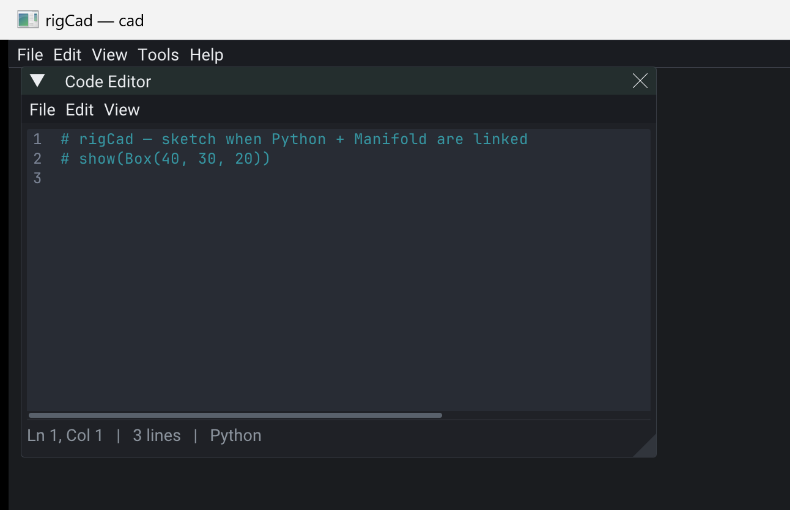

# rigCad





Live-scripted **3D CAD** orchestration - code editor + Python sketches + Manifold CSG.

## Depends

| Pack | Role |
|------|------|
| **rigCodeEditor** | Sketch buffer UI |
| **rigPython** | Embed + `eval` |
| **rigManifold** | CSG to `CMesh` |
| **rigRender3D** | Present solids (hero) |
| **rigImGui** | Host shell / windows |

## Status

When both embeds report `available()`, `ready()` is true. The pack installs a
`rigcad` Python module (`box`, `difference`, `union`, `show`) and runs a starter
sketch that spawns a `CMesh` entity. No fake Run when embeds are missing.

```python
from rigcad import box, difference, show
show(difference(box(40, 30, 20), box(20, 14, 12)))
```

## Hero

```bash
cmake -S packs/rigCad/examples/cad -B packs/rigCad/examples/cad/build
cmake --build packs/rigCad/examples/cad/build
./packs/rigCad/examples/cad/build/bin/cad/cad --smoke
```

## Pi note

Author tool (ImGui + CPython + Manifold). Keep off lean install apps.

## License

MIT.

## Style

Format first-party `src/` and `examples/` with clang-format before commit (never `third_party/`).

```bash
./tools/format.sh
./tools/install-hooks.sh    # once per clone - pre-commit formats staged C/C++
```

Hooks only look for `clang-format` on PATH and warn, without formatting, when it is missing. Put it on PATH:

- **Windows:** install [LLVM](https://github.com/llvm/llvm-project/releases) (enable "Add LLVM to the system PATH"), or `winget install LLVM.LLVM`, then open a new shell. Confirm: `clang-format --version`.
- **macOS:** `brew install clang-format`
- **Linux:** `sudo apt install clang-format`

From a RigKit host checkout, `./tools/install-hooks.sh` wires every pack repo. Full policy: [RigKit packs Style](https://github.com/rigkid/RigKit/blob/main/packs/README.md#style).

[API/docs](https://rigkid.github.io/rigCad/)
